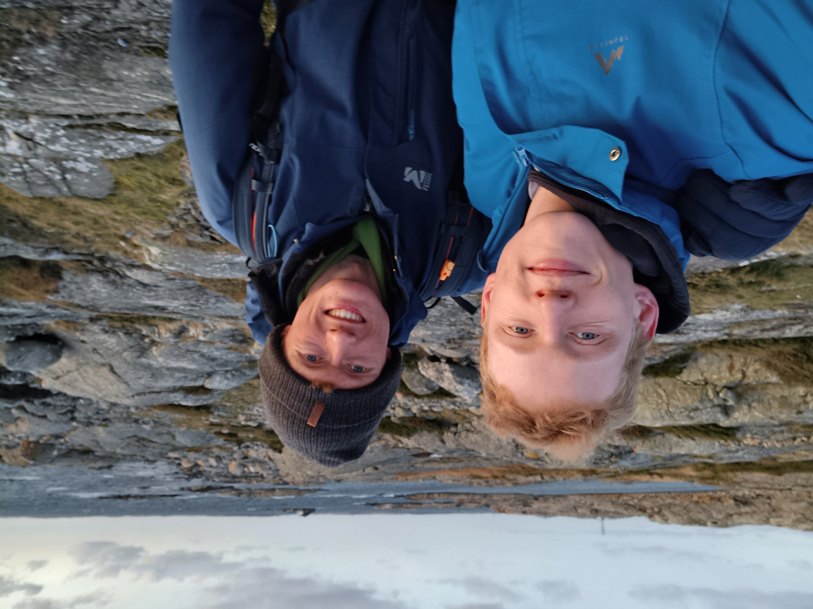

## About me
Hi everyone, I am a PhD student at the MPE in Garching! 

<figure align="right">
  
  <figcaption><i>Me (left) and my brother (right) in Gothenburg, Sweden.</i></figcaption>
</figure>

## Projects
- **PhD project** (in progress): "Evolution of Supermassive Black Hole Accretion at High Redshift" at the Max Planck Institute for Extraterrestrial Physics (MPE) under the supervision of Dr. Mara Salvato and Prof. Dr. Kirpal Nandra
- **Master’s thesis**: “Unveiling hyperluminous quasars around cosmic noon using Gaia DR3 XP and SPHEREx spectra” conducted at the Max Planck Institute for Astronomy (MPIA) in Heidelberg under the supervision of Dr. Julien Wolf and Dr. Silvia Belladitta
- **Bachelor’s thesis**: “Passively Evolving Galaxies in the Vicinity of the Quasar APM 08279+5255 at 
Redshift z = 3.9” at the Landessternwarte Heidelberg, supervised by Prof. Dr. Jochen Heidt

## Research interests
My particular interest lies in investigating dynamic processes in active galactic nuclei and the formation 
and evolution of (super-) massive black holes, approached from both observational and theoretical perspectives. I am especially fascinated by the role of extreme objects, such as quasars, in cosmic structure 
formation and galaxy evolution.

## Skills 
- **Languages:** German (native), English (fluent, C1), French (intermediate, B1)
- **Programming skills:**  Python, C++, ADQL, TOPCAT, Source Extractor
- **Activities:**  Triathlon and bouldering; regular voluntary work as a lifeguard team leader and instructor at 
the Baltic Sea; swimming coach with DLRG Nottuln and DLRG Dossenheim for over 10 years

## Contact
- **E-mail:** splitthoff@mpe.mpg.de

splitthoff.github.io
